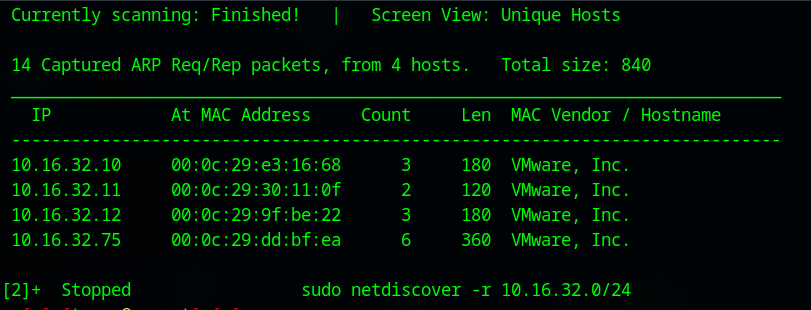
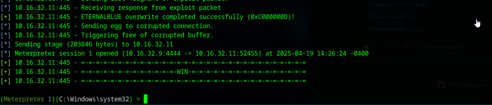

# Active Directory Penetration Testing Lab

**Tyree Payne · Internal network security assessment · Academic final-exam project**

I assessed a Windows and Active Directory lab to understand how an exposed legacy host, weak account passwords, and excessive administrative access could combine into a wider domain compromise. The work moved from host discovery and service enumeration to validated access, credential analysis, lateral movement, and recovery of lab artifacts.

The most important result was the relationship between the findings: patching one vulnerable workstation would address an initial entry point, but weak service-account passwords and broad administrative rights would still leave other paths open. My recommendations therefore address endpoint maintenance, identity security, privilege boundaries, and monitoring together.

> This was an educational lab, presented in the original submission as a fictional client engagement under the name “One Piece.” It is not presented here as a commercial client assessment. The repository documents the submitted work; it does not contain a deployable lab, exploit framework, or a new assessment of live systems.

## Start here

| Read | What it explains |
| --- | --- |
| [Case study](docs/case-study.md) | My process, decisions, obstacles, outcomes, and lessons |
| [Findings and remediation](docs/findings-and-remediation.md) | What was demonstrated, what remains uncertain, and how I would address the risks |
| [Evidence index](docs/evidence-index.md) | Screenshots and the original report sections supporting each claim |
| [Original exam report](report/FinaExamDocument.docx) | The submitted document, preserved as the primary project artifact |

## What I demonstrated

- Discovered four responding hosts in the assigned `10.16.32.0/24` lab subnet and correlated their exposed services with likely roles.
- Used vulnerability scanning to prioritize follow-up work, then documented a successful MS17-010/EternalBlue session against the Windows 7 host, Viper.
- Enumerated domain identities, recovered a valid account through password spraying, and documented offline recovery of two service-account passwords from Kerberos ticket material.
- Checked which recovered identities had administrative access before choosing subsequent targets. This exposed the difference between knowing a password and having useful privileges on a particular machine.
- Used authenticated remote administration and controlled file relocation to retrieve designated lab artifacts.
- Reviewed domain infrastructure and relationships, then connected the observations to remediation recommendations.

These are outcomes documented in the report and its screenshots, not claims that every host, account, vulnerability, or challenge was fully covered. Some artifact challenges remained unresolved, and no remediation retest is documented.

## Environment at a glance

```mermaid
flowchart TB
    Analyst[Assessment workstation]
    LAN[Assigned internal lab network]
    Analyst --> LAN
    LAN --> Viper[Viper — Windows 7 workstation]
    LAN --> Raptor[Raptor — Windows 10 workstation]
    LAN --> Legacy[Pegasus / BS62 — Windows Server 2008]
    LAN --> DC[Galactica / BS75 — Windows Server 2019]
    DC --- Identity[Active Directory, DNS and DHCP]
    Legacy --- Web[IIS and legacy server services]
```

This is a logical reconstruction of the original report’s network diagram. It does not establish measured firewall rules or segmentation. The report’s initial discovery inventory and later BS62 naming are not completely reconciled; that limitation is retained in the [case study](docs/case-study.md#environment-and-scope).

## The reasoning behind the workflow

| Decision | Why it mattered |
| --- | --- |
| Discover hosts before selecting targets | Start with an inventory instead of treating every address as an equivalent attack surface. |
| Correlate ports, OS information and scanner results | A scanner finding is a lead; host context determines whether it is relevant and worth validating. |
| Validate a selected legacy-host finding | Demonstrate an access path rather than report only a list of CVEs. |
| Investigate domain accounts after the foothold | Host access and domain identity can expose different paths through an environment. |
| Verify privileges for recovered accounts | Recovered credentials are useful only where authentication and authorization actually permit access. |
| Adapt when a remote shell was inconvenient for artifact handling | Retrieve the lab evidence through an account and directory I could access, while documenting that this did not prove broad data-loss-prevention bypass. |
| Turn access paths into a remediation plan | Explain which control should interrupt each part of the chain, not just which tool produced a result. |

## Tools and techniques

**Discovery and assessment:** Netdiscover, Nmap/Zenmap, Nessus, HTTP banner inspection.  
**Access and identity analysis:** Metasploit, Kerbrute, Impacket, NetExec, Hashcat, John/Johnny, BloodHound.  
**Artifact investigation:** CyberChef, barcode/QR decoding, Notepad++ whitespace inspection, metadata inspection, image steganography tools, and shell automation for nested archives.

The case study explains each tool’s role and the limits of its output. Passwords, hashes, and challenge-answer strings are not repeated in the public narrative; the original lab submission retains its original content.

## Selected evidence

### Discovery established an initial inventory

### A selected finding was followed through to a session

See the [evidence index](docs/evidence-index.md) for captions, provenance, and supporting sections.

## What I would improve next

I would keep a single reconciled asset register, record the exact privilege level for every session, separate scanner findings from confirmed exploitation, and assign each recommendation a verification step. I would also keep raw evidence locally and sanitize a separate publication copy at the time of testing. These are improvements to the workflow, not work claimed to have already been completed.

## Portfolio

[Explore my interactive portfolio](https://mrnxcho.github.io/tyree-pokemon-portfolio/) and visit the Project Lab to read the project summary.

## References and attribution

The project evidence comes from my original final-exam report. The deeper documents cite Microsoft, NIST, and joint government guidance where they discuss updated defensive recommendations. Those references inform the retrospective analysis; they are not evidence that I implemented or tested those controls in the exam.
